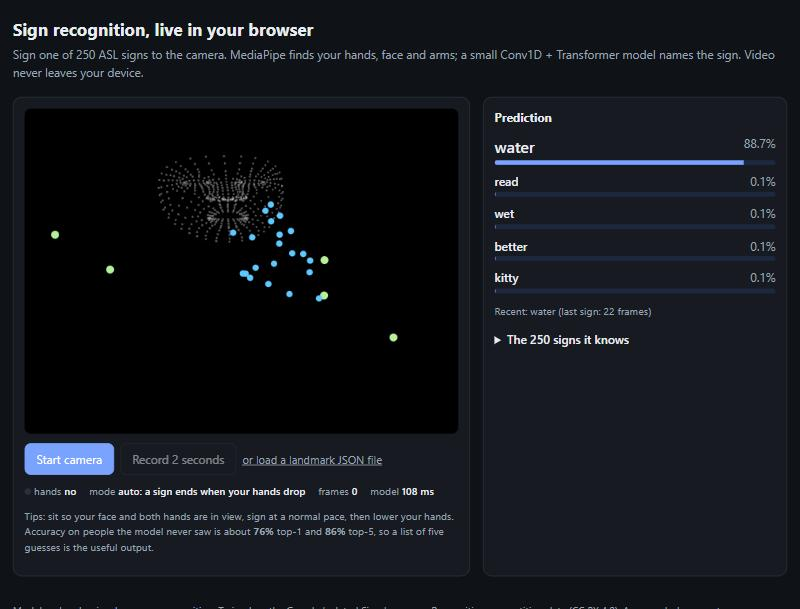
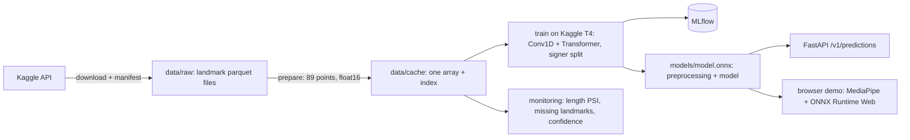

# Isolated sign language recognition: 250 ASL signs, live in the browser

Recognises **250 American Sign Language signs** from a webcam, in the browser, from MediaPipe landmarks.
Trained on the [Google Isolated Sign Language Recognition](https://www.kaggle.com/competitions/asl-signs)
data (94,477 videos of 21 signers, as landmarks) and shipped as a production-style system:

- **Signer-independent evaluation:** 4 of the 21 signers (18,022 videos) are never used in training, so
  the score says how the model does on a person it has never seen
- **Conv1D + Transformer** (2.1 million parameters, 8.5 MB) trained on a Kaggle T4 GPU, tracked in **MLflow**
- **All preprocessing inside the ONNX graph:** point selection, left/right-hand mirroring, normalisation,
  velocities and frame sampling. Training, the API and the browser run the same code, so they can't drift
- **Live webcam demo** (MediaPipe Holistic + ONNX Runtime Web): video never leaves the device
- **FastAPI** service on ONNX Runtime (no PyTorch), **Docker**, **CI**, a **model card** and **drift
  monitoring**

> **A research demo, not an interpreter.** It recognises single, isolated signs from a fixed list. It does
> not understand sentences, grammar or fingerspelling. See the [model card](MODEL_CARD.md).

## Results

Accuracy over 250 signs on the **18,022 videos of the 4 held-out signers** (participants 4718, 26734,
37779, 61333). Final-epoch weights; no checkpoint was picked on these signers.

| Model | Top-1 | Top-5 |
|---|---:|---:|
| **Conv1D + Transformer** | **0.7552** | **0.8578** |
| Bag of frames (MLP on the same features averaged over time) | 0.6653 | 0.8437 |
| Most frequent sign | 0.0041 | |

**What the baseline shows:** averaging the frames throws away the order of the movements. That costs 9
points of top-1 but only 1.4 points of top-5. The averaged features already narrow the sign down to a
handful of candidates; the order of the movements is what picks the right one among them.

**The shipped file, checked separately:** the exported `model.onnx` was also scored on 300 raw held-out
videos (all 250 signs) downloaded to the laptop, through the API's own parquet reader and ONNX Runtime,
with no PyTorch: **top-1 0.797, top-5 0.887**. That is consistent with the full held-out score, given
the small sample. The browser (ONNX Runtime Web) and the API return identical probabilities for the same
recording.

**Where it fails:** the most frequent confusions are *awake → wake* (37 of 75), *glasswindow → tooth*,
*that → stay*, *cat → kitty*, *mouth → lips*, *pencil → pen*, *quiet → shhh*, *scissors → cut* and
*goose → bird*. Several of these pairs are signed the same or almost the same way, or differ mainly in
the mouth, so part of this error is in the labels rather than the model. This is why the demo shows five
guesses. Full tables, the hardest signs and the MLflow run ids are in [RESULTS.md](RESULTS.md), generated by
`python -m islr.report`.

**How this compares with Kaggle:** the competition scored TensorFlow Lite models on a hidden test set
that only Kaggle has. These numbers come from this project's own signer split, so they are **not
comparable with the leaderboard**, and no Kaggle submission was made.

Training: 100 epochs, batch 64, AdamW (peak learning rate 0.001, weight decay 0.05), label smoothing 0.2,
mixed precision, 97 minutes on a Kaggle Tesla T4. Held-out top-1 climbed from 0.630 at epoch 5 to 0.705
at epoch 15, then to 0.741 at epoch 60 and 0.755 at epoch 100. Kaggle notebook:
[ASL Signs Conv1D Transformer with ONNX Export](https://www.kaggle.com/code/faresayman1/asl-signs-conv1d-transformer-with-onnx-export).

## Demo



A recording of **"water"** by one of the held-out signers, loaded as a landmark file and replayed on the
canvas: the face (white), the dominant hand at the chin (blue) and the arms (green). The model gives
"water" 88.7%. This is one of the easiest signs (0.99 top-1 over its held-out videos); the hard cases are
in the confusions above.

Start it with `uv run uvicorn islr.serve.api:app --port 8030` and open <http://localhost:8030/demo/>. With
a camera, sign at a normal pace with your face and hands in view, then lower your hands. The demo cuts a
sign when the hands drop (or use "Record 2 seconds"). On a laptop, the model takes about 6 ms per sign in
the browser once warm; MediaPipe itself is the slow part.

## Architecture



**Inside `model.onnx`** (input: raw landmarks `[frames, 543, 3]`, NaN where a part was not detected;
output: 250 probabilities):
1. keep 89 points: nose, 40 lip points, both hands, shoulders to wrists; x and y only;
2. if the left hand is seen in more frames than the right, mirror the sequence, so left-handed signers
   look like right-handed ones. In a sample of the data only about 3% of videos were left-hand dominant,
   so without this the model would barely learn them. A test checks that a mirrored signer gets
   identical features;
3. normalise by the sequence's own centre and spread; add velocities and the dominant hand's shape relative
   to its wrist (398 features per frame);
4. keep at most 64 evenly spaced frames;
5. 2 stages of 3 depthwise Conv1D blocks (kernel 17) and 1 Transformer block, width 192, masked mean
   pooling and a linear classifier.

Exported with a dynamic frame axis (opset 17). It matches PyTorch to within 4 × 10⁻⁷ for 1 to 300 frames.

## Quick start

Needs Python 3.12 and [uv](https://docs.astral.sh/uv/). The data needs a Kaggle API token, and the
competition rules must be accepted on kaggle.com.

```bash
uv sync --extra train                          # CUDA PyTorch on Windows, CPU PyTorch on Linux
uv run python scripts/download_data.py         # 300 held-out videos (~170 MB); --all for the full 56 GB
uv run python -m islr.data                     # -> data/cache
uv run python -m islr.baseline                 # majority + bag-of-frames baselines
uv run python -m islr.train                    # GPU recommended; the real run used the Kaggle notebook
uv run python -m islr.track --run models/run --source local   # log the run to MLflow
uv run python -m islr.export                   # -> models/model.onnx + meta.json (parity checked)
uv run python -m islr.report                   # RESULTS.md from MLflow
uv run python -m islr.evaluate                 # score model.onnx on the downloaded held-out files
uv run python -m islr.monitoring               # drift report
uv run uvicorn islr.serve.api:app --port 8030  # http://localhost:8030/docs and /demo/
```

Quick smoke run: `uv run python -m islr.train --epochs 1 --limit 200`.

Docker (API + demo; the model is mounted read-only): `docker compose up --build`. The image installs only
ONNX Runtime, not PyTorch.

## API

Base URL `http://localhost:8030`. Interactive docs are at `/docs`; the schema is in [openapi.json](openapi.json).

| Method | Path | Returns |
|---|---|---|
| GET | `/health` | `{"status": "ok"}` |
| GET | `/v1/model` | model details, held-out scores and MLflow run ids |
| GET | `/v1/signs` | the 250 signs |
| POST | `/v1/predictions?top_k=5` | the top signs with probabilities |

`POST /v1/predictions` takes either:
- **JSON** in MediaPipe's layout: `{"frames": [{"face": [[x, y, z], …], "left_hand": …, "pose": …,
  "right_hand": …}]}`, leaving out any part that was not detected in a frame; or
- **multipart** with a `landmarks` file in the competition's parquet format.

The response also gives `frames`, `frames_used`, `dominant_hand`, `hands_detected_frames` and
`latency_ms`. Every error uses the same shape, `{"error": {"code", "message", "details"}}`. The codes are
`unsupported_media_type` (415), `payload_too_large` (413), `validation_error`, `invalid_landmarks`,
`too_many_frames`, `no_landmarks` and `not_found`.

## Monitoring

`python -m islr.monitoring` compares new videos with the 76,455 training videos. On the 300 downloaded
videos of the held-out signers:

| Check | Kind | Value | Threshold | Result |
|---|---|---:|---:|---|
| Length PSI | input | 0.202 | 0.2 | warn |
| Dominant hand missing (change) | input | 0.067 | 0.15 | pass |
| Lips missing (change) | input | 0.008 | 0.15 | pass |
| Pose missing (change) | input | 0.000 | 0.15 | pass |
| Confidence drop | performance | −0.021 | 0.10 | pass |

The four new signers really do sign at a different pace (sampling noise alone would give a PSI of about
0.03), yet the model is slightly *more* confident on them. So input drift raises a warning to check a
labelled sample, and only a confidence drop recommends retraining. That rule was changed after seeing this
result; the [model card](MODEL_CARD.md#monitoring) explains why. It also records how the check was first
fooled: 41 failed downloads, all of them long videos, had faked a length PSI of 0.90.

## Project layout

```
configs/default.yaml        paths, held-out signers, model and training settings
scripts/download_data.py    Kaggle download (sample or full) + manifest
src/islr/
  landmarks.py              parquet reader, point selection, mirror map
  features.py               preprocessing as a torch module (exported into the ONNX graph)
  augment.py                affine, time resampling, frame and part dropout
  model.py                  Conv1D + Transformer, end-to-end export wrapper
  data.py                   raw parquet -> compact cache
  train.py / baseline.py    training and baselines (writes the run folder)
  track.py / report.py      MLflow logging, RESULTS.md from MLflow
  export.py / evaluate.py   ONNX export with a parity check, scoring the shipped file
  monitoring.py             drift checks
  serve/api.py              FastAPI service + demo files
app/web/                    browser demo (MediaPipe Holistic + ONNX Runtime Web)
tests/                      synthetic signers: features, mirroring, training, export, report, API contract
```

## Data and licence

The data is the **Google - Isolated Sign Language Recognition** competition data (Google, 2023,
[kaggle.com/competitions/asl-signs](https://www.kaggle.com/competitions/asl-signs)), licensed under
[CC BY 4.0](https://creativecommons.org/licenses/by/4.0/). The landmark files are not in this repository;
download them with your own Kaggle account. The trained model is derived from that data and is shared under
the same attribution. The code is MIT-licensed ([LICENSE](LICENSE)).
